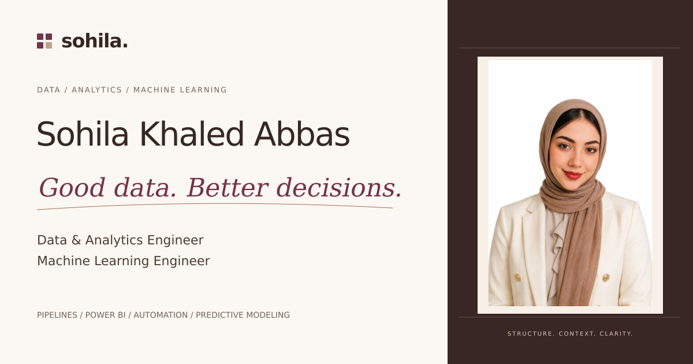

# Sohila Khaled Abbas — Data & Analytics Portfolio

**[Explore the live website →](https://sohila-khaled-abbas.vercel.app/)**

Data & Analytics Engineer | Machine Learning Engineer | Power BI, Python, SQL, Airflow, dbt, Databricks, PySpark | ETL/ELT | Data Warehousing | Predictive Modeling



The active website source is **[`portfolio-site/`](portfolio-site/)**. Vercel builds this directory from `main` and publishes it at [sohila-khaled-abbas.vercel.app](https://sohila-khaled-abbas.vercel.app/).

## What's inside

- 91 public repository records: 75 original project previews and 16 attributed learning forks.
- 12 detailed case studies covering data engineering, analytics, machine learning, and automation.
- 22 reporting project pages, 17 real preview images, and 12 existing public Power BI reports.
- Actual architecture/model assets, source-file previews, clear in-progress labels, and direct project links.
- Experience, résumé, mentoring, community activities, credentials, learning resources, and professional contact links.
- Portrait-inspired ivory, taupe, cocoa, and muted burgundy design; light/dark themes, subtle animation, motion controls, responsive layouts, keyboard project search, and image dialogs.

Counts reflect the public content snapshot reviewed on 30 October 2026. Project code and report samples are presented with their source context; they do not establish client impact or employment.

## Run the current website

Use Node.js 22 or later. The portable site has no application dependencies and needs no package installation.

```sh
git clone https://github.com/Sohila-Khaled-Abbas/sohila-k-abbas-website.git
cd sohila-k-abbas-website/portfolio-site
npm run build
npm run check
npm run dev
```

Open `http://localhost:4173/`. Build output is generated in `portfolio-site/dist/` and is not committed.

## Repository map

| Path | Purpose |
| --- | --- |
| [`portfolio-site/`](portfolio-site/) | Active static website, generator, content, assets, and hosting configuration |
| [`portfolio-site/docs/`](portfolio-site/docs/README.md) | Authoritative architecture, design, content, provenance, and deployment guides |
| [`docs/`](docs/README.md) | Repository navigation and legacy application notes |
| `src/`, `public/`, root package/config files | Preserved original React/Vite application, separate from the active Vercel website |
| `.github/workflows/` | Repository workflows, including portable-site validation |

The legacy application is retained for history and reference. See [legacy application notes](docs/LEGACY_APPLICATION.md) before working at the repository root.

## Publish and maintain

Vercel project: **`sohila-khaled-abbas`**. Root Directory: **`portfolio-site`**. Framework: **Other**. Build: **`npm run build`**. Output: **`dist`**. Merges to `main` use Vercel's Git integration; a second deployment pipeline is not required.

Firebase Hosting configuration is also included as an alternative. See [deployment instructions](portfolio-site/docs/DEPLOYMENT.md), the [content guide](portfolio-site/docs/CONTENT_GUIDE.md), and [contribution guide](CONTRIBUTING.md).

The public site contains no original CV PDFs or private repository content. Its main content is static HTML; Power BI reports load only after a visitor chooses the interactive view. Contact forms prepare an email draft locally. Technology logos identify tools and do not imply affiliation.

## Documentation

[Architecture](portfolio-site/docs/ARCHITECTURE.md) · [Design system](portfolio-site/docs/DESIGN_SYSTEM.md) · [Content sources](portfolio-site/docs/CONTENT_SOURCES.md) · [Preview sources](portfolio-site/docs/preview-sources.md) · [Migration record](portfolio-site/docs/portfolio-migration.md) · [Release notes](CHANGELOG.md)
