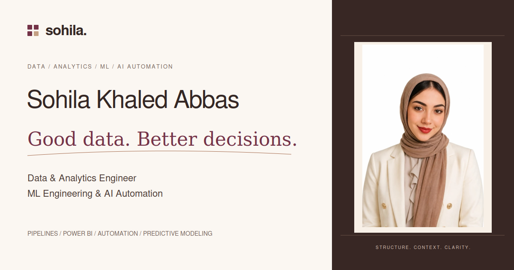

# Sohila Khaled Abbas — Data & Analytics Engineer | ML Engineering & AI Automation

A complete, portable personal portfolio for Sohila Khaled Abbas: data and analytics engineering, machine learning, business intelligence, ETL/ELT, data warehousing, automation, and practical learning.

**Live website:** [sohila-khaled-abbas.vercel.app](https://sohila-khaled-abbas.vercel.app/)



This is the active website source. In the GitHub repository it lives in `portfolio-site/`; Vercel builds this directory. The original React application at the repository root is preserved separately.

## Content

- Dedicated home, work, dashboards, about, résumé, learning, and contact pages.
- Twenty-two permanent reporting project pages with 17 real screenshots, 12 public Power BI links, available report files, and project presentations.
- Explicit in-progress status for PixelFed and the n8n queue setup.
- Preview pages for all 77 original repositories, including 12 detailed case studies. Seventeen learning forks retain upstream attribution.
- Actual architecture and model images, documented workflow overviews, and source-file previews.
- A searchable directory of 94 accessible public GitHub repositories, including clearly attributed forks.
- An interactive three-step retail example with explicitly invented records.
- Interactive About page with source-derived counts, four animated workflow diagrams, and project evidence.
- Seven enrolled Udemy courses, a hiring-team overview, attributed professional recommendations, and dated historical recognition.
- Recent and popular LinkedIn posts with optional official previews and direct post links.
- About, learning resources, and verified professional contact links.
- Portrait-led animated hero with technology logos, pause and reduced-motion support; responsive navigation, keyboard screenshot dialogs, light/dark themes, and a print-friendly résumé.
- A portrait-inspired ivory, taupe, cocoa, and muted burgundy palette, with shared light/dark tokens and verified text contrast pairs.
- Shareable gallery/list filters, Ctrl/Command+K project search, copyable project links, and a 1200 × 630 social preview card.
- Community, credential collection, mentoring, and collaboration pages with an approval-only business inquiry form.

Project descriptions were checked against the public repository READMEs on 30 October 2026. No employment, business impact, production uptime, or client testimonials are inferred from portfolio code. Sample graphics are illustrative.

## Build and run

Requires Node.js 22 or later. The public pages are static; the approval-only Vercel inquiry endpoint uses a pinned phone-validation dependency.

```sh
npm ci --ignore-scripts
npm test
npm run build
npm run check
npm run dev
```

Deploy the generated `dist/` directory. `vercel.json` and `firebase.json` are included. See [deployment instructions](docs/DEPLOYMENT.md) for Vercel import and Firebase Hosting commands.

Edit `content/` and `src/`, then rebuild. The static generator creates the complete site; no visitor needs JavaScript for the main page content or repository links. JavaScript adds directory search and filters, themes, and interactive examples.

See the [documentation index](docs/README.md) for architecture, design tokens, content editing, deployment, and provenance.

Run `npm ci --ignore-scripts` before tests, local development, or deployment. No visitor analytics or tracking is included. Theme and animation preferences are saved in browser local storage.

See [preview sources and accessibility](docs/preview-sources.md) for report provenance and interaction details.

See [portfolio migration](docs/portfolio-migration.md) for source provenance and project preview coverage.

## Automatic project discovery

Public GitHub projects refresh hourly through the repository workflow, with visitor-side metadata refreshes in between. New original repositories receive project pages; curated summaries, media, methods, and case studies are preserved. [Synchronization and maintenance guide](docs/AUTOMATIC_PROJECT_SYNC.md).

## Verified business inquiries

Only reviewed businesses with private invitations can open and prepare an inquiry. Approved identities are fixed; detailed work scope, budget, email, and optional international phone inputs are validated again on the server. Public communication is through email, LinkedIn, and GitHub. [Verification, invitations, and revocation](docs/BUSINESS_INQUIRIES.md).

## Learning and professional evidence

The [learning log](https://sohila-khaled-abbas.vercel.app/learning/) connects seven enrolled Udemy courses to public notes and projects, with topic search, subject filters, and shareable URLs. Enrollment is clearly separated from course completion and earned credentials. The [hiring-team overview](https://sohila-khaled-abbas.vercel.app/recruiters/) organizes skills around inspectable project work. Public LinkedIn recommendations and historical recognition appear on the Community page with attribution and dates. See [source and maintenance notes](docs/LEARNING_AND_EVIDENCE.md).
