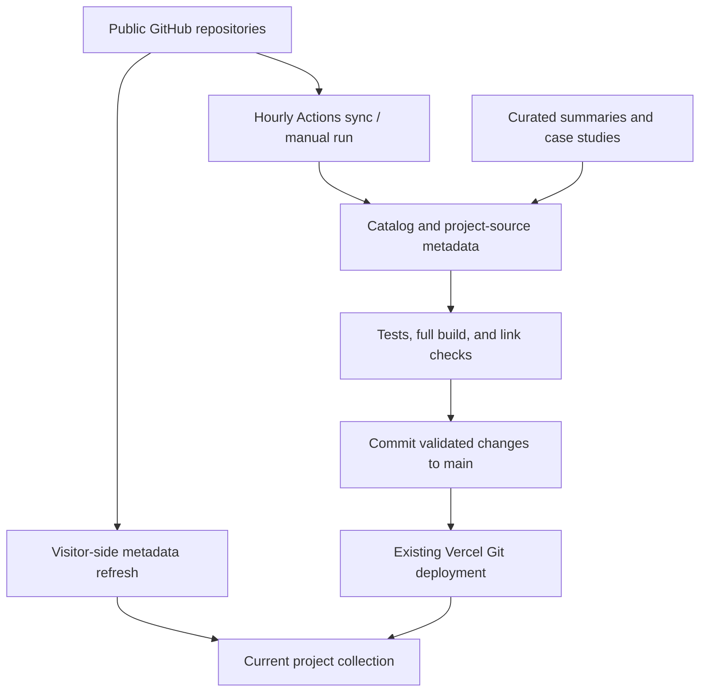

# Automatic GitHub project updates

The portfolio now combines a generated public-source catalog with preserved editorial project descriptions and case studies.

## What updates automatically

| Source change | Portfolio behavior |
| --- | --- |
| New public repository | Appears in the live project collection; the next scheduled sync also creates a searchable static project page. |
| Description, language, topics, archive state, or website link changes | Public metadata refreshes and becomes part of the next published source snapshot. |
| A push changes a project | Its source activity date refreshes; the scheduled sync reads its updated public README and refreshes the source excerpt. |
| A curated project changes | Its written summary, methods, screenshots, case study, and explicit project status are preserved. A separate source-update section shows current GitHub information. |
| A repository becomes private or disappears | It is omitted from the next complete public catalog. Private repositories are never enumerated or fetched by this feature. |
| GitHub is unavailable or rate limited | The live view retains the published snapshot. The scheduled job fails before replacing catalog files. |

## Two refresh paths



`.github/workflows/sync-projects.yml` runs hourly at minute 17 and supports **Run workflow**. GitHub schedules are best-effort and can be delayed. This is periodic synchronization, not an instant cross-repository webhook. The workflow also runs when its implementation/configuration changes on `main`.

The source snapshot is built and checked before it is committed. Existing Vercel Git integration deploys commits on `main`; the workflow does not need a Vercel token or deploy hook. GitHub's own workflow recursion protection means a commit made with `GITHUB_TOKEN` does not start the separate push-validation workflow, so the sync job performs the build and checks itself.

`github-live.mjs` refreshes the Work collection and project source information from GitHub's public REST endpoint. It caches public metadata in the visitor's browser for 15 minutes to reduce API usage. New entries link directly to GitHub until their static preview is generated by the next successful sync. A complete validated response is required before the live collection is replaced. No API key, authentication token, or private account data is sent to the browser.

## Add a project

1. Create a **public** repository under `Sohila-Khaled-Abbas`.
2. Set its GitHub description, topics, and **Website** link.
3. Write a useful README: purpose, implementation, setup, evidence, and limitations.
4. The portfolio discovers it automatically. Use **Actions → Sync public GitHub projects → Run workflow** to refresh the static pages sooner.

The GitHub sync cannot infer a new case study, independently verify results, or declare a project production ready. To add a bespoke title, methods, screenshot, or story, edit the project's record in `content/project-details.json` and set `auto_generated` to `false`. The sync updates only its `github` source fields and current public homepage, preserving the editorial fields.

The FDE roadmap has an explicit curated card, website link, source files, and preview image. It is included in the homepage spotlight and learning resources.

## Run and verify

```bash
cd portfolio-site
node --test tests/github-sync.test.mjs
node scripts/sync-github.mjs
npm run build
npm run check
```

Unauthenticated local runs limit README refreshes to 20 per run to conserve GitHub's public rate limit; remaining source excerpts are updated in later runs. GitHub Actions uses its ephemeral `GITHUB_TOKEN`, scoped to writing this portfolio repository, and processes all changed READMEs. It only lists the public `/users/.../repos` endpoint and filters public ownership again.

The portfolio's own activity excludes synchronization-only commits, preventing a feedback loop where every sync creates another source update. The generated catalog uses stable sorting and keeps the same date during a day, so an unchanged source produces no additional commit.

If `main` is later protected against direct writes, configure this workflow to open a review PR, or grant a deliberately reviewed bypass. Do not weaken branch rules just to make synchronization work. Check the Actions log if the scheduled run fails; keep the existing snapshot available.

## References

- [GitHub repository REST API](https://docs.github.com/en/rest/repos/repos#list-repositories-for-a-user)
- [Scheduled workflow behavior](https://docs.github.com/en/actions/reference/workflows-and-actions/events-that-trigger-workflows#schedule)
- [Workflow recursion and GITHUB_TOKEN](https://docs.github.com/en/actions/how-tos/write-workflows/choose-when-workflows-run/trigger-a-workflow#triggering-a-workflow-from-a-workflow)
- [Vercel Git deployments](https://vercel.com/docs/git)

## Python learning roadmap

`python-learning-roadmap` has an explicit curated project record, public GitHub Pages link, original social preview, homepage spotlight and learning-resource entry. It connects the Boot.dev/ITI/CS50P curriculum to Python data tools and to the existing DE and FDE roadmap repositories. Its project briefs remain labeled as learning work; only the offline pipeline reference is described as implemented. The existing public-source sync preserves these editorial fields.
